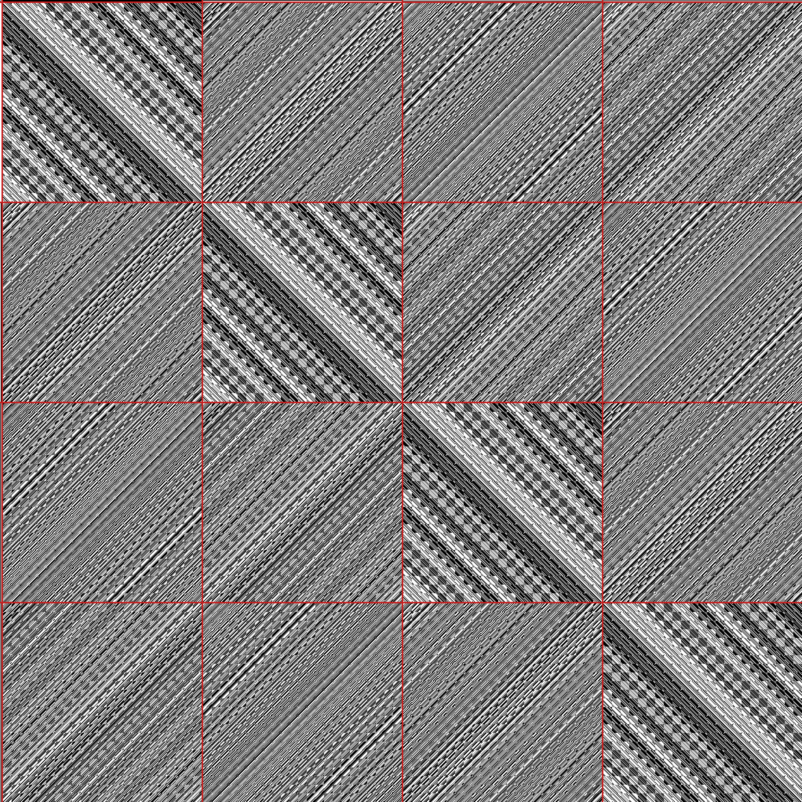

# A skew Hadamard matrix of order 2120

Jeffery Kline

**Status: release candidate for version 0.1.0.** The claims are frozen
and audited (see [ADMISSION.md](ADMISSION.md)). There is no tag, archive or
DOI yet, so there is no stable citation.

The paper is [paper/main.pdf](paper/main.pdf); its source is
[paper/main.tex](paper/main.tex). The matrix is
[data/order-2120.signs.gz](data/order-2120.signs.gz).



The matrix, one pixel per entry: white is +1 and black is −1. Thin red gaps
separate the four border rows and columns and the four copies of the field
with 529 elements. The four diagonal blocks are the same pattern; the others
are its reflections, whose stripes run the other way. Figure 1 of the paper
shows the layout as a schematic (Lemma 2).

## Introduction

A Hadamard matrix $H$ of order $N$ is skew if $H+H^{\mathsf T}=2I$. Skew
Hadamard matrices are conjectured to exist at every order divisible by 4, and
doubling a skew matrix gives another, so for each odd $m$ one asks for the
least $t$ such that a skew matrix of order $2^t m$ is known. For $m=265$ the
Cati–Pasechnik database records $t=4$, from order 4240, and the 2025 census
of Đoković and Seberry lists order 1060 among the undecided cases.

This repository gives a skew Hadamard matrix of order $2120=2^3\cdot265$. We
found no earlier published construction at this order, so the least exponent
for 265 is at most three.

The matrix comes from four sign patterns on the field with $529=23^2$
elements. Each pattern changes sign with the quadratic character of
$\mathbb F_{23}$ along every line through the origin, and all four come from
one list of eight signs. Their Fourier energies sum to a constant, a condition
that reduces to eight integer sums that can be checked by hand. A bordered
Goethals–Seidel array then turns the four patterns into the matrix. On the
same field the cyclotomic constructions of Momihara and Xiang need eight
blocks.

The method extends. A vector form of Turyn's cyclic expansion carries the
four patterns to every odd power of the field, and patterns of the same kind
exist in characteristics 7 and 263. Together they give skew Hadamard matrices
of order $4(p^{2n}+1)$ for $p\in\lbrace7,23,263\rbrace$ and every odd $n$; the
patterns at 263 rest on a machine computation. Four is the least number of
blocks possible for an all-skew family on these groups.

## What is new

The skew orders known before this work include the Paley orders, the
Wallis–Whiteman and Momihara–Xiang orders $4(q+1)$ from cyclotomic blocks,
the Szekeres orders, products with amicable matrices, doubling and many
computer-found orders, collected by Cati and Pasechnik and by Đoković and
Seberry. New here:

1. **Principal result: a skew Hadamard matrix of order 2120** (paper
   Theorem 1). Its certificate is eight integer sums over $\mathbb F_{23}$,
   checkable by hand, together with a bordered array. The recorded least
   exponent for odd part 265 drops from four to at most three.
2. **Seeds in characteristics 7, 23 and 263.** A seed is a list of four
   odd sign patterns on a group whose Fourier energies (squared magnitudes of
   their Fourier transforms) sum to the same value at every nonprincipal
   character. One rule, fixed by eight signs, gives a seed on
   $\mathbb F_{p^2}$ for $p=7$, $23$ and $263$ (Section 3); at 263 the eight
   sums are machine-computed.
3. **Extension to odd powers.** Every such seed gives four skew blocks on
   $\mathbb F_q^{\,n}$ for odd $n$, hence skew Hadamard matrices of order
   $4(p^{2n}+1)$ for $p\in\lbrace7,23,263\rbrace$ and every odd $n$
   (Theorem 3 and Corollary 4). No priority is claimed for these orders beyond
   2120, and at 263 they rest on the machine computation.
4. **Four is the minimum.** Call a set $B$ skew if $B$ and $-B$ partition the
   nonzero elements. If $k$ skew sets on an abelian group of order
   $v\equiv1\pmod4$ cover every nonzero difference equally often and
   $k\equiv2\pmod4$, then $4\mid\mathrm{ord}_\ell(2)$ for every prime
   $\ell\mid v$. On these groups every such family, and every seed, has $4\mid k$ members
   (Theorem 5).

Not new:

- The orders $4(p^{2n}+1)$ beyond 2120. We make no priority claim for them;
  at $p=7$ and $n=1,3,5$ they are Paley orders $q+1$ with $q$ a prime
  $\equiv3\pmod4$.
- The cyclic expansion itself, which is Turyn's (1971), recast for difference
  sets by Momihara (2020); Theorem 3 replaces its scalar input by a vector of
  four patterns.
- The bordered array, a variant of the Goethals–Seidel and Wallis–Whiteman
  arrays.
- The inequivalence remark uses Orrick's four-row products.

These statements rest on a bounded comparison recorded in
[audit/PRIOR-ART.md](audit/PRIOR-ART.md). We have not found a skew Hadamard
matrix of order 2120 in the sources checked; two papers could be seen only in
publisher preview, the papers citing Momihara and Xiang were not screened, and
unindexed work cannot be excluded, as listed there. This is not a claim of global novelty.

## Earlier work

- **Cati and Pasechnik (2024)**,
  [*A database of constructions of Hadamard matrices*](https://arxiv.org/abs/2411.18897),
  Table 5: the least known power-of-two multiples of odd parts with skew
  matrices; $265(4)$.
- **Đoković and Seberry (2025)**, *Census of symmetric and skew Hadamard
  matrices of order 4v for odd v < 2500*, Hadamard 2025, Sevilla: lists
  $v=265$ as undecided.
- **Momihara and Xiang (2018)**,
  [*Skew Hadamard difference families and skew Hadamard matrices*](https://arxiv.org/abs/1801.08776):
  cyclotomic skew families and the bordered arrays; on $\mathbb F_{529}$ their
  families have eight blocks.
- **Koukouvinos and Stylianou (2008)**, *On skew-Hadamard matrices*, Discrete
  Math. 308: the survey of constructions checked against 2120 and 1060.
- **Turyn (1971)**, *On C-matrices of arbitrary powers*, Canad. J. Math. 23,
  and **Momihara (2020)**, *A recursive construction for skew Hadamard
  difference sets*, Electron. J. Combin. 27(3): the cyclic expansion.
- **Lehmer (1976)**, *Existence criteria for supplementary difference sets*,
  J. Austral. Math. Soc. 21: a doubling-and-parity argument for cyclotomic
  classes modulo a prime.
- **Orrick (2008)**, *Switching operations for Hadamard matrices*, SIAM J.
  Discrete Math. 22: the binary code and four-row products.

## Evidence and limits

| Claim | Status |
|---|---|
| Lemma 2: a seed gives a skew Hadamard matrix of order $4(v+1)$ | proved on paper |
| The seed at 23 (eight sums) | proved on paper, with the arithmetic shown; also certified computation |
| The order-2120 matrix | certified computation: every row pair, the diagonal and skewness checked on the archived file; the file is also rebuilt from the seed byte for byte |
| The seed at 263 | certified computation (eight sums and hypothesis (L)); the line-representative facts are also checkable by hand |
| The seed at 7 (eight sums) | proved on paper, with the arithmetic shown; also certified computation |
| Theorem 3 (expansion) and Corollary 4 | proved on paper; the case $p=263$ inherits the computation above |
| Theorem 5 (minimum) | proved on paper |
| Inequivalence to matrices whose automorphism group is doubly transitive on columns | proved on paper (remark) |
| Priority at 2120 | bounded search; see [audit/PRIOR-ART.md](audit/PRIOR-ART.md) |

Limits:

- Order 1060 remains open. Theorem 5 covers only families in which every block
  is skew, so it does not rule out a two-block construction at 1060.
- We do not know which primes admit seeds. Computer searches found none at
  $p=71,103,151$, and a narrower search none at $167$ and $199$.
- The orders beyond 2120 are not compared with every other construction.

## Reproduce

The certificates need a C compiler with `__builtin_popcountll` (gcc or clang)
and Node.js (tested with v22.11.0); the
paper needs pdfLaTeX.

```sh
make verify NODE=/path/to/node   # about two seconds on one core
make paper                       # builds paper/main.pdf
```

`make verify` writes each output to `build/certificates/` and prints `MATCH`
for each file that equals its pinned copy in `evidence/`.
[VERIFICATION.md](VERIFICATION.md) maps each certificate to the step of the
paper it checks.

## Role of AI

AI assisted the derivations, the computer verification, the literature search
and the exposition under the author's direction. Process-separated AI reviews
checked the proofs and certificates; they are not independent expert peer
review, and no independent human expert has examined the proofs. The audits
and their dispositions are in [audit/LEDGER.md](audit/LEDGER.md).

## License

GPL-3.0-only. See [LICENSE](LICENSE).
